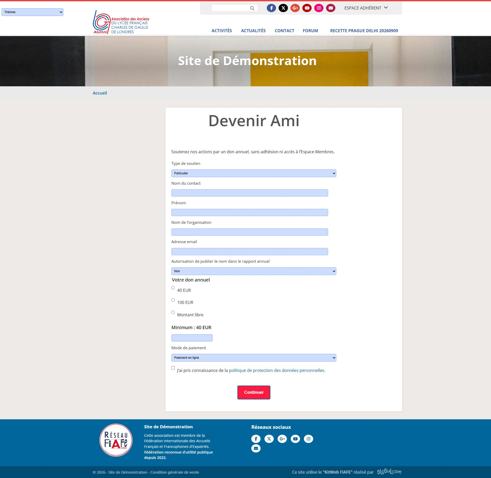
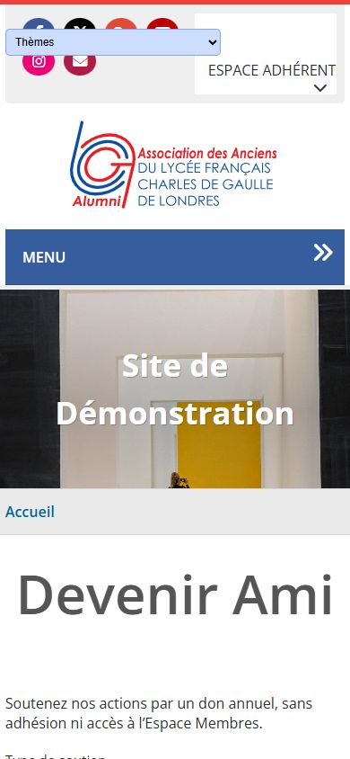
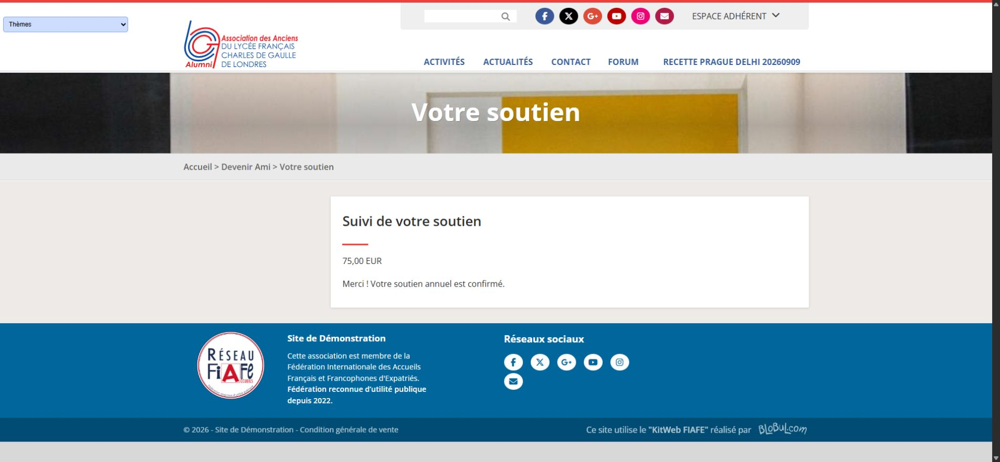

# Recette DEV — 12 novembre 2026

Cible unique : `https://dev.blobul.com`, plugin chargé depuis `plugins/association-dons/`. SPIP 4.4.30, PHP 8.4.27, Association 6.10.27, Bank 7.2.0 ; schéma du module 1.4.0. Branche `codex/donateurs-schema-association`. Aucun site client modifié, aucune release publiée.

## Source et installation

La base de code fonctionnelle finale est le commit `9e8eb19336a6f1d078f5cb0353026215500987b9`. L’export correspondant porte le SHA-256 `c41228dba0367ec2b9ab93db90a0d790761df3245a01476803e79f91f7742b81` (43 fichiers vérifiés). La livraison finale de documentation inclut aussi le contrôle d’enregistrement de configuration dans la recette privée, sans modification de ce code d’exécution. Le reçu de déploiement final donne son commit exact ; il est conservé hors dépôt pour éviter une référence circulaire.

Chaque déploiement utilise `git archive` du commit exact, une sauvegarde privée des dons, des quatre tables complémentaires et de leurs métadonnées, la validation native du manifeste avant remplacement, puis une vérification SHA-256 de tous les fichiers et une purge du cache. Les tests sont exclus de l’archive. Les octets de l’archive font foi, Git pouvant normaliser les fins de ligne.

## Résultats vérifiés

| Domaine | Preuves et résultat |
| --- | --- |
| Règles | Montants stricts, minimum, identités, dates limites, période 2026–2027 puis annuelle, statuts et priorité de l’archivage : tests PHP réussis. |
| Structure | DDL MariaDB réel, clés uniques donateur/année, don et événements ; contraintes et conservation vérifiées. |
| Installation native | Création des quatre tables depuis zéro, migration 1.0 vers 1.4, conservation d’un donateur synthétique et conservation à la désinstallation. Les tables originales ont été remises en place après le test isolé. |
| Administration | Refus visiteur, autorisation administrateur, présence du menu natif, création, modification, recherche, archivage, validation email ; compilation des trois écrans privés sans erreur de squelette. Configuration valide enregistrée ; devise inconnue et montants incohérents refusés. |
| Paiement | Intention sans ancien don, création Bank sans adhérent, double soumission identique sans doublon, contenu modifié refusé, lien invalide refusé ; transaction non réglée ou insuffisante refusée. Règlement confirmé par pipeline : un don et une écriture, sans cotisation d’adhérent. |
| Concurrence | Quatre callbacks SSH simultanés sur une même transaction synthétique : une seule création de don et une seule écriture. Vérifié sur le même hôte SPIP, sans prétention de verrou distribué multi-nœuds. |
| Reprise | Relecture quotidienne des règlements Bank confirmés et rappel du callback : aucune double écriture. Préparation incomplète conservée et non rejouée. |
| Confirmation externe | Visiteur ou preuve vide refusés ; confirmation administrateur testée pour virement et Fondation. La Fondation ne génère pas de recette bancaire locale. |
| Public | Consentement, signature, minimum et jetons ; double soumission ; absence d’identité sur la page de paiement ; compilation sans erreur ; contenu anglais. Soumission réelle dans le navigateur jusqu’aux choix Bank de test, sans clic de paiement prestataire. |
| Notifications | Capture sans file ni email réel ; événement unique, pas de second envoi, contenu montant/année et anglais ; confirmation, rappel annulé après paiement, expiration, invitation unique après deux revues, lien de renouvellement réutilisant la fiche. |
| Contacts optionnel | Contacts 5.3.2 temporairement actif : rattachement, fiche organisation, échappement d’un nom malveillant, refus d’un identifiant inexistant et rendu du sélecteur. Les lignes des quatre tables Contacts ont été comparées avant/après : identiques. Plugin désactivé à nouveau. |

Les recettes SPIP sont `recette_installation_spip.php`, `recette_spip.php`, `recette_soutiens_spip.php`, `recette_public_spip.php`, `recette_notifications_spip.php`, `recette_contacts_spip.php`. Les sorties de la matrice finale sont conservées dans le dossier temporaire privé de travail avec les reçus de livraison.

## Rendu public

Contrôle dans Chrome de la page publique, sur ordinateur et à 390 px. Après correction CSS limitée au formulaire : boutons et cases alignés, largeur du document sans débordement horizontal. Les captures utilisent une configuration synthétique de recette et le code de présentation `3bf267f`, identique dans la base fonctionnelle finale.

La seconde capture montre le haut de page, pas l’intégralité du formulaire. Les écrans privés ont été testés par rendu natif serveur et contrôles d’autorisation ; aucune recette visuelle privée authentifiée n’est revendiquée. Le repli public sans Zcore n’a pas été essayé visuellement sur une seconde pile.

## Conservation et limites

À l’origine et après nettoyage : zéro don historique, zéro ligne dans chacune des quatre tables du module, 104 écritures comptables natives. Les recettes de migration ont utilisé des lignes synthétiques pour démontrer la conservation ; elles ne constituent pas une migration d’un portefeuille client réel. Les transactions, donateurs, suivis, périodes et notifications synthétiques ont été supprimés.

Les profils temporaires d’authentification ont été fermés et retirés. La configuration antérieure aux captures est restaurée : aucune URL juridique fictive n’est laissée active. Contacts reste facultatif et inactif sur DEV ; ses fichiers sont disponibles pour une nouvelle recette.

Avant mise en service client : renseigner les véritables informations de confidentialité, le journal et l’imputation des dons (l’imputation native DEV était vide), les moyens Bank et les instructions externes ; valider séparément encaissement et délivrabilité dans un cadre autorisé. Les tests ont capturé les messages et n’ont produit ni paiement réel ni envoi réel. Aucune garantie de réception email, aucun reçu fiscal, aucune production et aucun prélèvement automatique ne sont revendiqués.

## Parcours public vers fiche donateur — 12 novembre 2026

Code d’exécution du module : `883eb2e7ccfabc976efaf6fc7fbfcfe597a9853c`. Les surcharges de page du Core correspondent aux fichiers ciblés de `7fad24f` ; le Core actif n’a pas été remplacé dans son ensemble. Mode recette actif, notifications forcées à non.

Recette avec `RECETTE PARCOURS COMPLET 20261112`, destinataire `.invalid`, montant libre 75 EUR et virement fictif. Identifiants synthétiques : donateur 37, suivi 34, don 91211022, écriture 260721230124. Toutes ces lignes ont été nettoyées après la recette.

- Navigateur public : une soumission vide a affiché les erreurs nom/email/montant ; correction puis envoi du formulaire réel. Page de suivi : 75 EUR, en attente, bandeau et fil d’Ariane Blobul, aucun moyen de paiement réel.
- Serveur SPIP : l’intention reste absente des anciens dons avant confirmation, sans transaction Bank. Chargement de la fiche et de ses coordonnées, recherche du donateur et rendu privé avant/après confirmation sans erreur de squelette.
- Contrôleurs CVT privés : visiteur refusé, administrateur autorisé, preuve vide refusée ; confirmation avec preuve « RECETTE — aucun encaissement réel ». Le donateur devient à jour jusqu’au 31 décembre 2027. Une seconde confirmation conserve un seul don et une seule écriture.
- Navigateur public après confirmation : montant conservé, message « Merci ! Votre soutien annuel est confirmé. », aucune identité exposée. Un jeton invalide affiche le refus sans montant ni identité.
- Aucun événement email du module et aucun travail ajouté à la file pendant la confirmation. Aucune transaction Bank créée : 98 avant/après. Le mode recette interdit le transport email du module ; aucun paiement réel n’a été appelé.
- Nettoyage vérifié : dons et quatre tables complémentaires vides, comptabilité revenue de 105 à ses 104 écritures initiales. Configuration de recette laissée active pour Julien. Profil technique temporaire supprimé.

**Limite : recette visuelle du privé non validée.** L’authentification technique a réussi avec le helper officiel, mais le contrôle automatique a refusé l’ouverture du profil Chrome authentifié. Aucun autre procédé n’a été utilisé pour reproduire cette ouverture. Les vérifications privées ci-dessus portent sur les contrôleurs CVT et le rendu natif serveur sous identité technique administrateur ; elles ne constituent pas des clics dans une session privée du navigateur. Le parcours public est validé dans le navigateur ; la recette complète de bout en bout dans une interface authentifiée reste donc partielle.

