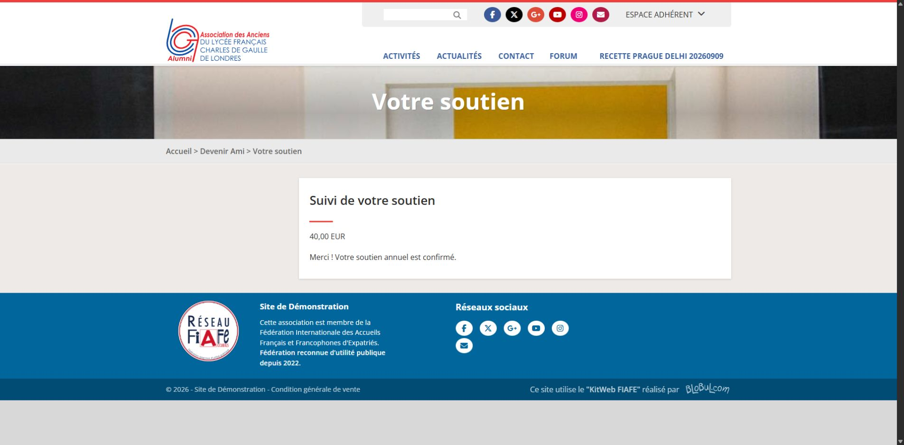

# Recette DEV — 13 novembre 2026

Cible : https://dev.blobul.com. SPIP 4.4.30 / PHP 8.4, Association 6.10.27, Bank 7.2.0. Mode recette désactivé, notifications actives conformément à la demande. Destinataire donateur de test : jul@blobul.com ; contact associatif configuré : contact@blobul.com.

## Verdict

Parcours public, paiement Stripe sandbox, confirmation, réceptions email, validations, droits et contrôleurs privés : réussis. **Recette visuelle du privé encore partielle** : le navigateur contrôlable redirige vers la connexion. Le profil technique authentifié n’a pas été rouvert après le refus du contrôle automatique lors de la passe précédente ; le pilotage de l’application desktop existante est également indisponible (accès système refusé). Aucun contournement ni changement de credential. Les fiches et les actions privées ont été contrôlées par le rendu SPIP et les contrôleurs CVT sous identité technique administrateur, pas par des clics privés authentifiés.

## Parcours exécutés

| Contrôle | Preuve / résultat |
| --- | --- |
| Configuration | Montants 40/100, minimum 40 EUR, Bank configuré en test, notifications actives, contact associatif valide ; mêmes valeurs en fin de recette. |
| Saisie incomplète | Erreurs nom/email/montant visibles, aucune intention créée. |
| Minimum et correction | Montant libre 1 EUR refusé ; bascule vers 40 EUR acceptée après correction du blocage navigateur. |
| Don Bank | Formulaire public réel : RECETTE 20261113 EMAILS BANK, suivi 41, donateur 45, 75 EUR. Demande reçue dans la boîte donateur. |
| Refus | Carte Stripe de test de refus : message de refus Stripe, soutien toujours en attente, aucune confirmation de règlement. Un premier essai du simulateur Bank avait révélé un bouton visible malgré le refus d’encaissement anonyme. |
| Acceptation | Checkout Stripe explicitement Sandbox, carte de test de succès ; transaction 260721230096 réglée via Stripe test, retour signé et confirmation publique. Aucun débit réel. |
| Frais Stripe | Le réglage Bank ajoute 2,36 EUR : encaissement sandbox 77,36 EUR, don et écriture de don 75 EUR. Ce supplément configuré était affiché avant paiement. |
| Notifications Bank | Confirmation au donateur et message distinct au contact associatif reçus en INBOX, montant 75 EUR et validité 2027. Journal des trois événements accepté. |
| Virement fictif | Formulaire public : RECETTE 20261113 EMAILS VIREMENT, suivi 42, donateur 46, 40 EUR. Contrôleur privé : preuve vide et visiteur refusés, confirmation avec référence RECETTE autorisée. Aucun virement bancaire effectué. |
| Notifications virement | Deux confirmations reçues en INBOX à 17:21 (UTC+1). Montant 40 EUR, validité 2027, retours à la ligne HTML présents ; message associatif sans jeton public. |
| Fiches privées | Recherche et rendu natif des deux fiches : bonnes identités, montants, soutiens réglés, statut à jour, fin 2027-12-31, journaux renseignés, formulaire de confirmation retiré après règlement. Zéro erreur de squelette. |
| Doublons | Rechargement public, second traitement manuel et rappel du pipeline Bank : un don et une écriture par soutien, trois événements de notification par donateur, aucune confirmation supplémentaire. |
| Accès | Jeton public invalide : refus sans montant ni identité. Accès privé déconnecté : redirection vers la connexion. |
| Mobile | Vue réelle à 390 px, document 375 px, formulaire 363,75 px ; choix utilisables, aucun débordement horizontal. |

## Réception des confirmations

Les preuves sont les messages dans Gmail, pas seulement le retour du transport :

- Bank, donateur : `1a1d5af68d9e0b81`, reçu le 13/11 à 17:13:21, destinataire jul@blobul.com.
- Bank, association : `1a1d5af6d3f1fdbe`, reçu à 17:13:22, destinataire contact@blobul.com, référence 41.
- Virement, donateur : `1a1d5b68b7d4333f`, reçu à 17:21:08, destinataire jul@blobul.com.
- Virement, association : `1a1d5b695b8f39fb`, reçu à 17:21:11, destinataire contact@blobul.com, référence 42.

La demande initiale Bank est également reçue (`1a1d5ac93f65af97`). Les messages ont été lus sans modifier leurs labels. Les liens signés complets et les corps ne sont pas recopiés ici. Les alternatives texte et HTML des confirmations virement ont été contrôlées.

## Anomalies corrigées et livraison

- Montant libre inactif : retrait des contraintes navigateur qui bloquaient aussi un montant proposé ; minimum et précision monétaire restent validés côté serveur lorsque le montant libre est choisi.
- Notifications HTML : alternative texte conservée ; texte échappé puis retours à la ligne convertis avant passage au gabarit Facteur/Core. Vérification contre l’injection de balises et réception réelle après correction.
- Simulateur Bank : rendu limité aux profils déjà autorisés à encaisser une simulation. Les autorisations n’ont pas été élargies. Test natif : absent pour visiteur, présent pour administrateur.
- Ticket Bank : le premier ticket interne classait le don comme réadhésion. Les écritures `objet=don` sont désormais exclues de ce rapprochement ; le pipeline du module produit « Don Ami n° 41 » avant comme après règlement. Le ticket déjà reçu n’a pas été renvoyé.

Module : `c9cbd874505cd22f65b46014b355bba9191267e2`, branche `codex/donateurs-schema-association`, export SHA-256 `816e0eefba7405fc14a9a4474c7b3ecc189d27b100668a8240b2238f9dbbde38`, 53 fichiers vérifiés. Sauvegardes privées et purge du cache effectuées.

Adaptateur Bank : branche `codex/recette-dons-simu-visibilite`, commit `db5bc42` ; seuls `presta/simu/payer/acte.html` et `bank_presta_options.php` livrés. Le fichier options actif initial était identique à la source après normalisation LF ; copie précédente sauvegardée avant remplacement. Empreintes après livraison : `fe41c790c46b0d43f969e5630d427198e235df2d167c427c9243f868dc68c15d` (template), `466a3f2cd4e1b7b4f3873821fd258047e9056f80a66ac9aa78017afe9c67d838` (options).

Tests de régression SPIP public, notifications capturées, configuration par rubrique et soutiens Bank/virement/Fondation : réussis. Tests PHP des règles, de structure et de description des commandes Bank : réussis. Les contrôles Saisies et des surcharges ne remontent aucune erreur de squelette.

## Données conservées et limites

Les deux fixtures 45 et 46 sont conservées pour permettre le contrôle visuel privé encore manquant, et pour maintenir utilisables les liens des emails reçus. Elles sont explicitement préfixées RECETTE. Deux dons et deux écritures synthétiques subsistent : comptabilité passée de 104 à 106. Les fixtures temporaires des tests automatisés sont nettoyées. Les journaux réels de réception sont conservés ; aucun envoi incertain ni transaction acceptée n’a été rejoué.

La politique de confidentialité reste une URL fictive de DEV et les instructions de virement sont fictives. Les autres prestataires ne sont pas tous recettés : le parcours externe effectivement exécuté est Stripe sandbox. Les rappels et renouvellements ont été contrôlés en capture serveur, pas par des envois réels supplémentaires. Aucune production, release ou version de manifeste modifiée.

